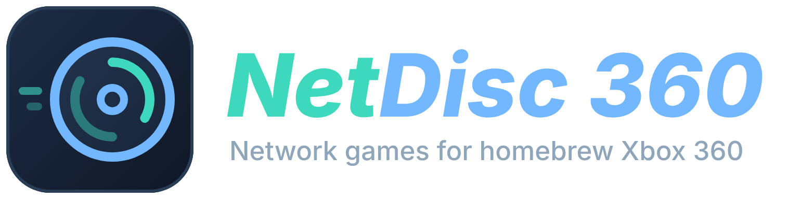
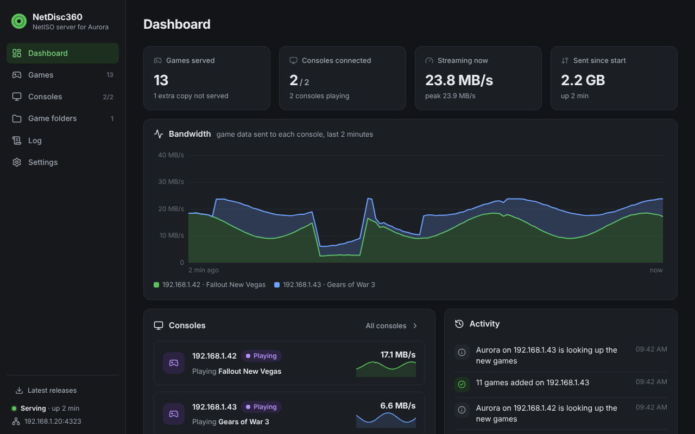
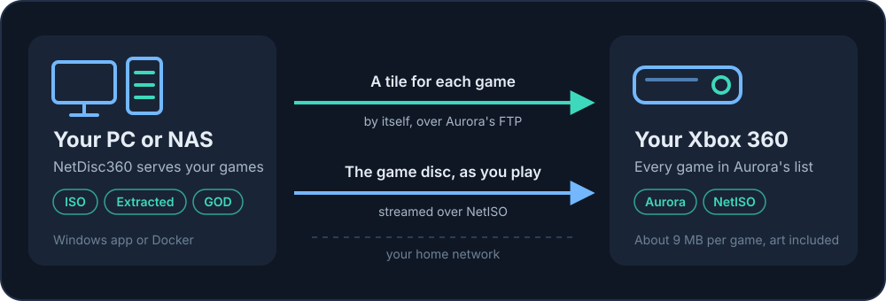
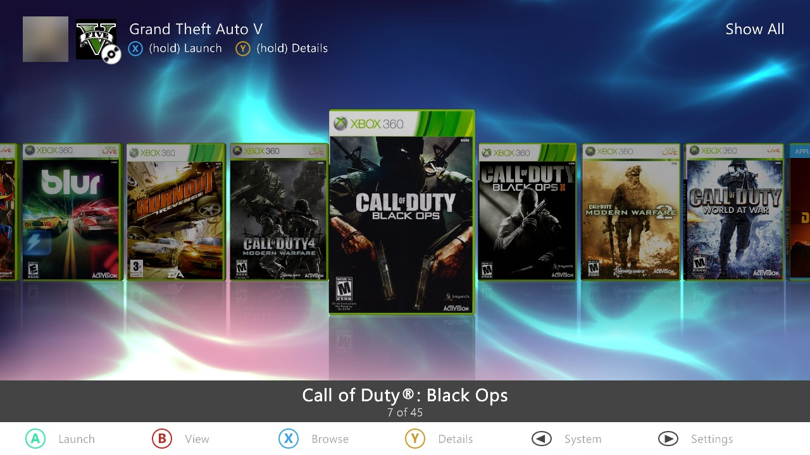
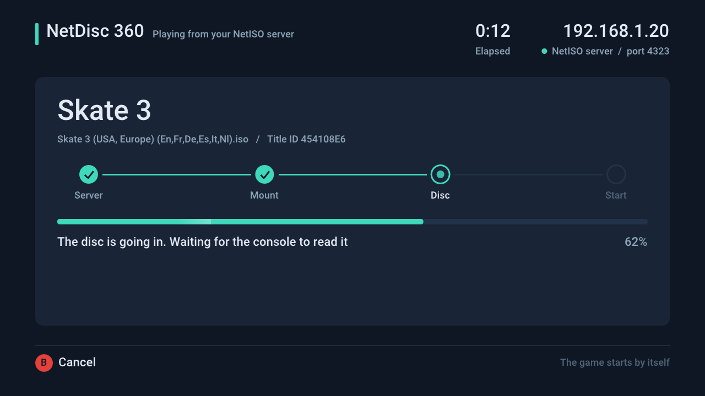
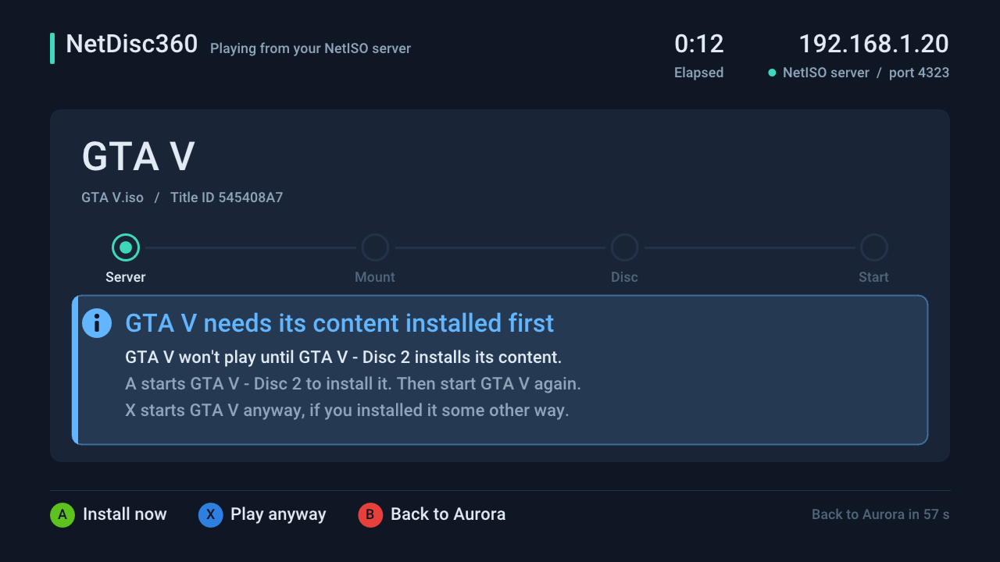

<p align="center">
  
</p>

<p align="center">
  <b>Play your whole Xbox 360 library from your PC or NAS. Every game shows up in Aurora as if it were installed, without filling your Xbox's hard drive.</b>
</p>

<p align="center">
  <a href="https://github.com/marcusisdahl/NetDisc-360/releases/latest"></a>
  <a href="https://github.com/marcusisdahl/NetDisc-360/actions/workflows/ci.yml"></a>
  <a href="#docker"></a>
  <a href="LICENSE"></a>
</p>

<p align="center">
  <a href="#quick-start">Quick start</a> &nbsp;·&nbsp;
  <a href="#install">Install guide</a> &nbsp;·&nbsp;
  <a href="#docker">Docker</a> &nbsp;·&nbsp;
  <a href="#troubleshooting">Troubleshooting</a> &nbsp;·&nbsp;
  <a href="#more-xbox-360-homebrew">More homebrew</a>
</p>

<p align="center">
  
  <br>
  <sub>The dashboard on your PC or NAS: your games, every console and what it's playing, and how fast each game streams.</sub>
</p>

Keep your games on your PC or NAS and play them on your Xbox 360 just like installed games. Each one appears in Aurora with its name, cover art, title updates and DLC; pick it and it starts.

- **Your Xbox's drive stays free.** The games stay on your PC or NAS. The console keeps only a small launcher and Aurora's cover art for each one (about 9 MB in all), so even a 20 GB drive holds about 1,400 games, and 2,300 games take about 20 GB instead of many terabytes. See [How many games fit](#how-many-games-fit).
- **Set it up once.** Start NetDisc 360 on your PC, choose your game folders, and that's it. New games show up in Aurora by themselves and removed ones disappear. It can start with Windows, and on a NAS it runs in Docker.
- **Every console in the house.** Several Xboxes can play from the same library at the same time, and the dashboard shows what each one is playing.
- **Every kind of game copy.** ISOs, extracted games and Games on Demand, from as many folders as you like. Nothing to convert or copy.
- **Multi-disc games just work.** Each disc gets its own tile, and when a game asks for its next disc, NetDisc 360 puts it in for you. A game with an install disc, like GTA V, offers to install it first.
- **Feels like the real thing.** A loading screen you can cancel with B, a clear message when something is wrong, and the Guide keeps working in your games.
- **Faster than the disc.** With a gigabit USB network adapter, games read at up to about 26 MB/s, where the console's own DVD drive manages about 16 MB/s at best and NetISO on its own about 7 MB/s.

**For the homebrew crowd.** NetDisc 360 is an open-source [NetISO](https://consolemods.org/wiki/Xbox_360:Playing_Games_over_Network_(NetISO)) server that replaces `netiso-srv`, for any modded 360 with DashLaunch and Aurora: RGH, JTAG, or a stock console with BadUpdate or ABadAvatar. Extracted games and GOD packages are served as virtual discs, so nothing gets converted to ISO. Each game gets a small launcher XEX with the game's own Title ID and Media ID, so Aurora scans it as the real game and fetches its art, title updates and DLC itself. A DashLaunch plugin patches `NetISO.xex` in memory: it stops NetISO from killing the Guide, lifts its read loop from 4 KB per request to 64 KB or more with a bigger receive buffer, and answers a game's `XSwapDisc` by mounting the other disc. One exe for Windows with a web dashboard, or a Docker image for Linux and NAS. [How it works](docs/how-it-works.md) has the details.

<p align="center">
  
</p>

**Best with [CUsbEnet](https://github.com/marcusisdahl/CUsbEnet).** It makes a gigabit USB network adapter work on the Xbox, whose own network port is 100 Mbit/s, at most about 12 MB/s. See [Speed](#speed) and [More Xbox 360 homebrew](#more-xbox-360-homebrew).

## Contents

- [Quick start](#quick-start)
- [What you need](#what-you-need)
- [Install](#install) (step by step)
- [Docker](#docker)
- [Playing](#playing)
- [Speed](#speed)
- [How many games fit](#how-many-games-fit)
- [More Xbox 360 homebrew](#more-xbox-360-homebrew)
- [Troubleshooting](#troubleshooting)
- [Updating](#updating)
- [Security](#security)
- [The server in detail](#the-server-in-detail)
- [How it works](#how-it-works)
- [Build](#build)

## Quick start

You need a modded Xbox 360 with DashLaunch and Aurora, the NetISO plugin (`NetISO.xex` 1.0, from [ConsoleMods](https://consolemods.org/wiki/Xbox_360:Playing_Games_over_Network_(NetISO))), and a Windows PC or a NAS with your games on the same network. [What you need](#what-you-need) links to each of them.

1. Download `NetDisc.exe` and `NetIsoTiles.xex` from the [Releases](../../releases) page.
2. Copy `NetISO.xex` and `NetIsoTiles.xex` to your USB drive, add a text file `NetISO.xex.txt` next to them with your PC's IP address in it, and load both plugins in `launch.ini`:

   ```ini
   [Plugins]
   plugin1 = Usb:\NetISO.xex
   plugin2 = Usb:\NetIsoTiles.xex
   ```

3. In Aurora's settings, turn on the FTP server and add the scan path `Hdd1:\NetISO` with depth 1.
4. On the PC, start `NetDisc.exe` and add your game folders on the dashboard that opens in your browser. On Linux or a NAS, run it in Docker instead and open `http://<its address>:8360`:

   ```sh
   mkdir -p ~/netdisc && sudo chown 1000:1000 ~/netdisc
   docker run -d --name netdisc --network host --restart unless-stopped \
     -v /path/to/games:/games:ro -v ~/netdisc:/config \
     -e NETDISC_WEB_PASSWORD=<a password> ghcr.io/marcusisdahl/netdisc-360
   ```

5. Reboot the console. Within a minute or two your games show up in Aurora's game list. Pick one and play.

[Install](#install) goes through each step in detail, and [Docker](#docker) has every setting. To load games as fast as your network allows, see [Speed](#speed).

## What you need

NetDisc 360 brings the PC side and the console plugin that ties it to Aurora. The rest comes from other homebrew projects, linked here.

**On the console**

- **A modded Xbox 360** on the same network as your PC. RGH and JTAG consoles work, and so do stock consoles with [BadUpdate](https://github.com/grimdoomer/Xbox360BadUpdate) or ABadAvatar 1.3 (see ConsoleMods' [BadUpdate guide](https://consolemods.org/wiki/BadUpdate)), with [XeUnshackle](https://github.com/Byrom90/XeUnshackle) or [XeUnshackle-Max](https://github.com/klofi/XeUnshackle-Max). NetDisc 360 is developed on ABadAvatar 1.3 with XeUnshackle-Max, which carries on into Aurora by itself after the console starts (auto continue).
- **[Aurora](https://consolemods.org/wiki/Xbox_360:Aurora)**, the dashboard your games show up in (tested with 0.7b.2), and **[DashLaunch](https://consolemods.org/wiki/Xbox_360:DashLaunch)**, which loads the plugins at boot.
- **The NetISO plugin**, `NetISO.xex` 1.0 by cOz. It makes a game on the server look like a disc in the console's drive, so NetDisc 360 can't work without it. It isn't open source and comes with no license to pass it on, so it isn't included here: download `Nova+NetISO-Aurora0.7b.zip` from [ConsoleMods' NetISO page](https://consolemods.org/wiki/Xbox_360:Playing_Games_over_Network_(NetISO)) and take only `NetISO.xex` from it. The modified `Nova.xex` in that kit is not needed.
- **`NetIsoTiles.xex`** from this project's [Releases](../../releases) page.

**On your PC or NAS**

- **`NetDisc.exe`** from the [Releases](../../releases) page, for Windows 10 or 11, or the [Docker image](#docker) for Linux or a NAS. It replaces NetISO's own server, so you don't need `server.exe` or `netiso-srv`.
- **Your games:** ISOs, extracted game folders (with `default.xex` at the top) or Games on Demand packages.

**Optional:** [CUsbEnet](https://github.com/marcusisdahl/CUsbEnet) with a gigabit USB network adapter for faster loading, and [FastFTP](https://github.com/marcusisdahl/Xbox360_FastFTP) for copying files to the console; see [More Xbox 360 homebrew](#more-xbox-360-homebrew).

## Install

### 1. Set up the console

1. **Copy the plugins to the root of your USB drive** (the one DashLaunch reads `launch.ini` from):

   ```
   Usb:\
     launch.ini
     NetISO.xex          <- from ConsoleMods' NetISO kit, see What you need
     NetISO.xex.txt      <- you make this one in step 2
     NetIsoTiles.xex
     NetIsoTiles.ini     <- optional, see Speed
     CUsbEnet.xex        <- optional, see More Xbox 360 homebrew
   ```

2. **Tell NetISO where your PC is.** Make a text file `NetISO.xex.txt` next to `NetISO.xex` with one line: your PC's IP address, for example `192.168.1.20`. The server's dashboard shows this address. Give your PC a fixed address in your router, so it doesn't change.

3. **Load the plugins in DashLaunch.** Open `launch.ini` and set its `[Plugins]` section like this (leave the rest of the file as it is):

   ```ini
   [Paths]
   Default = Hdd:\Apps\Aurora\Aurora.xex

   [Plugins]
   plugin1 = Usb:\CUsbEnet.xex
   plugin2 = Usb:\NetISO.xex
   plugin3 = Usb:\NetIsoTiles.xex
   ```

   `Default` is where your Aurora is; this makes the console boot straight into it. Leave out the `CUsbEnet` line if you don't use a USB network adapter, and number the others from `plugin1`. DashLaunch loads at most 5 plugins.

4. **Turn on Aurora's FTP server and add the game folder.** Reboot the console into Aurora. In Aurora's settings, make sure the FTP server is on, and under Content, Scan paths, add `Hdd1:\NetISO` with depth 1 (the folder can be empty; the PC fills it).

   Aurora's FTP login is `xboxftp` / `xboxftp` unless you changed it. Changing it is a good idea (see [Security](#security)); then enter the same login on the PC.

### 2. Start the server

**On Windows:** put `NetDisc.exe` anywhere, for example in the folder with your games, and double-click it. It opens its dashboard in your web browser (`http://127.0.0.1:8360`) and keeps running behind its icon in the notification area, by the clock.

- The first time, it serves the folder it is in, if that folder has games (otherwise the list starts empty). Add your other game folders with **Add a folder**. Subfolders count too. The **Game folders** page lists them; removing one there only stops serving it.
- The **Dashboard** lists the setup steps on a first run and ticks them off as they are done. Then it shows how many games it serves, which consoles are connected, how fast each one's game streams (a chart of the last two minutes), and what happened lately.
- The **Games** page shows every game it serves as covers or a list, with its format, Title ID and size, and which console is playing it. Click a game for its details. A game that is in your folders more than once shows at the top, where you choose which copy to play.
- The **Consoles** page lists every console that has used the server: whether it's on (the server pings each console every 30 seconds, so one that's switched off shows as Offline), what it plays, what it was sent, whether its Aurora answers, when its game folders were updated, and its last five events (a game started, games added, launchers updated to a new version). Choose there which consoles get your games in Aurora (every console that connects, or only the ones you name).
- The **Settings** page has **Aurora's FTP login** (enter it if you changed it in Aurora) and **Start with Windows**, to have the server start, hidden, every time you sign in.
- **Latest releases**, at the bottom of the sidebar, links to the newest NetDisc 360, [FastFTP](https://github.com/marcusisdahl/Xbox360_FastFTP) and [CUsbEnet](https://github.com/marcusisdahl/CUsbEnet) downloads.
- **Close the browser tab and forget about it.** The server keeps running. Click its icon to open the dashboard again (starting `NetDisc.exe` again does the same); right-click it and pick **Quit NetDisc 360** to stop the server.
- When Windows Firewall asks, allow it on **private networks**.
- **From your phone or another computer:** on the **Settings** page, set a password and turn on **Other devices can open it**. Then open `http://<your PC's address>:8360` there.

Settings are saved in `%APPDATA%\NetDisc 360\netdisc.ini`, with the FTP password encrypted for your Windows user. The **Log** page shows what the server does. The exe also still runs from a command prompt with [options](#the-server-in-detail), with the same dashboard.

**With Docker** (Linux, a NAS, a Raspberry Pi): see [Docker](#docker) below.

### 3. Turn on the console

Turn the console on. Within a minute or two of Aurora starting, the server adds a folder for each game to `Hdd1:\NetISO`, asks Aurora to scan it, and Aurora fetches the names and cover art. Your games are then in Aurora's game list next to your installed games, in the Xbox 360 category too. It doesn't matter whether the PC or the console starts first.

<p align="center">
  
  <br>
  <sub>Aurora on the Xbox: games from your PC sit in the game list with their covers, just like installed games.</sub>
</p>

For more consoles, repeat step 1 on each one (their `NetISO.xex.txt` holds the same PC address). Each console gets its own game folders and can play a different game at the same time.

## Docker

The same server runs in Docker on Linux, a NAS or anything else with Docker, with the same dashboard. Put [`docker-compose.yml`](docker-compose.yml) in a folder, set the path to your games in it, then:

```
mkdir config && sudo chown 1000:1000 config
docker compose up -d
```

and open the dashboard at `http://<the machine's address>:8360`. Set a password for it on its **Settings** page (or with `NETDISC_WEB_PASSWORD`): without one, anyone on your network can open it and change its settings. `docker compose logs -f` shows the server's log too.

It uses the image `ghcr.io/marcusisdahl/netdisc-360`, published with each release for x86-64 and ARM64. To build it yourself instead, clone this repository and run `docker compose up -d --build`.

| Setting | Default | |
|---|---|---|
| volume `/games` | | Your games (read-only is fine). Mount more folders under it, like `/games/isos`, or anywhere else and add them on the dashboard. |
| volume `/config` | | The dashboard's settings (`netdisc.ini`). It must be writable by user 1000:1000. |
| `NETDISC_WEB_PASSWORD` | | The dashboard's password. Or `NETDISC_WEB_PASSWORD_FILE` with the path of a Docker secret. Set this way, it can't be changed on the dashboard. |
| `NETDISC_WEB_PORT` | 8360 | The dashboard's port. `0`: no dashboard. |
| `NETDISC_XBOX` | every console that connects | Only these consoles' game folders are kept up to date: IP addresses, separated by commas. Needed on Docker Desktop (Windows, macOS), where the server doesn't see the consoles' own addresses. |
| `NETDISC_FTP_USER` | `xboxftp` | Aurora's FTP login. |
| `NETDISC_FTP_PASSWORD` | `xboxftp` | Or `NETDISC_FTP_PASSWORD_FILE` with the path of a Docker secret. |
| `NETDISC_NO_CATEGORY` | | `true`: leave Aurora's Xbox 360 category alone. |
| `NETDISC_NO_SCAN` | | `true`: don't ask Aurora to scan after changes. |
| `NETDISC_NO_PUSH` | | `true`: only serve games; leave the console alone. |
| `NETDISC_XBOX_FOLDER`, `NETDISC_AURORA` | `/Hdd1/NetISO`, `/Hdd1/Apps/Aurora` | As `--xbox-folder` and `--aurora`. |
| `NETDISC_PORT`, `NETDISC_FTP_PORT` | 4323, 21 | |
| `NETDISC_VERBOSE` | | `true`: log every request. |
| `TZ` | UTC | Your time zone, for the log's times. |

- The variables from `NETDISC_XBOX` down are only the first start's settings. Once the server has saved its settings in `/config`, what's saved there wins, and you change them on the dashboard. (`NETDISC_WEB_PASSWORD`, the ports and `NETDISC_VERBOSE` always apply.)
- The compose file uses **host networking**, so the console reaches the server on port 4323 of the host and the server sees the console's real address. With port mapping instead (`ports:` with `4323:4323` and `8360:8360`, as on Docker Desktop), set `NETDISC_XBOX`.
- The server runs as user 1000:1000. If it can't read your games, set `user:` in the compose file to an ID that can (and give `config` to that ID).
- Without Docker Compose: `docker run -d --name netdisc --network host --restart unless-stopped -v /path/to/games:/games:ro -v /path/to/config:/config -e NETDISC_WEB_PASSWORD=<a password> ghcr.io/marcusisdahl/netdisc-360`.

## Playing

Pick the game's tile. The loading screen shows four steps (Server, Mount, Disc and Start), a bar that fills to 100%, and how long it has been since you pressed the tile. Then the game starts.

<p align="center">
  
  
  <br>
  <sub>The loading screen, and the notice for a game whose install disc hasn't been installed yet.</sub>
</p>

- **B cancels at any step** and goes back to Aurora at once.
- Right after a reboot the console can't reach the server for a minute or two, and the NetISO plugin needs a little longer still. For the first 4 minutes after boot the screen waits for both instead of failing.
- When something goes wrong, the screen says what and what to do: the server doesn't answer, the NetISO plugin isn't loaded, the game is no longer on the server, the disc didn't show up, a different game is in the drive, or the game didn't start. **A** goes back to Aurora and **X** tries again; after a minute it goes back to Aurora by itself.
- **Games with an install disc** (GTA V, Forza Motorsport 4) check for the install first. If the install disc's content isn't on the console's hard drive or USB storage, the screen asks: **A** starts the install disc so you can install it, **X** plays anyway, **B** goes back to Aurora. Without its install, GTA V freezes at "Loading story mode".
- **Games on more than one disc** get a tile for each disc. When the game asks for another disc (GTA V's install disc asks for the play disc once it has installed), NetDisc 360 puts that disc in over the network and the game carries on, as if you had swapped it. A notification says when the game is ready to swap and when the other disc goes in. Every disc of the game has to be in your game folders.

There is no unmount step: the plugin keeps the last game mounted until another one is mounted.

## Speed

NetISO on its own loads games at about 7 MB/s however fast your network is, because it asks the server for 4 KB at a time and waits for each piece before asking for the next. `NetIsoTiles.xex` has it ask for 64 KB at a time and gives its connection a 64 KB receive buffer, with nothing to set up.

With NetDisc 360 it can go faster still. Make a text file `NetIsoTiles.ini` on the root of your USB drive (next to the plugins) with these two lines, and reboot the console:

```ini
read_kb=256
rcv_kb=64
```

Installing GTA V from its install disc over NetISO, on a console with a TP-Link UE306 USB adapter and CUsbEnet:

| | Speed |
|---|---|
| NetISO on its own (4 KB per request) | about 7 MB/s |
| `read_kb=64`, no bigger receive buffer (`rcv_kb=0`) | about 17 MB/s |
| `read_kb=256`, no bigger receive buffer | about 19 MB/s |
| `read_kb=256`, `rcv_kb=64` | about 26 MB/s |

That is about as fast as the adapter goes on the console's USB 2.0 port. The console's own network port stops at about 12 MB/s.

- `read_kb` is how much NetISO asks for in one request: `4` (NetISO's own), `16`, `64` (the default), `256` or `1024`. NetISO's own server, `netiso-srv`, cuts replies of 128 KB or more short, so keep `64` with it; NetDisc 360 serves any of them.
- `rcv_kb` is the receive buffer for NetISO's connection: `16`, `32`, `64` (the default), `128` or `256`; `0` leaves NetISO's own.
- The file can also go on the root of `Hdd1:`; the USB drive's is used if both are there. Any other value is ignored, and NetISO then works as it does on its own.
- Each game's `netiso.log` says what the plugin set, in two lines starting `NetISO reads:` and `NetISO's receive buffer:`.

## How many games fit

Each game takes about 9 MB on the console's drive, measured on a console with 39 games:

- **5.8 MB for its launcher**, the folder in `Hdd1:\NetISO` that Aurora shows as the game.
- **About 3.1 MB for its art**, which Aurora downloads for any game in its list: screenshots (1.3 MB), background (1 MB), cover (0.66 MB) and banner.

The game itself stays on your PC or NAS. A game's install content (GTA V's install disc puts 8.3 GB on the drive), title updates and DLC take space as they would with the disc. The table keeps 1 GB free for Aurora, your saves and updates.

| Console drive | Free for you | Games that fit |
|---|---|---|
| 20 GB | about 13 GB | about 1,400 |
| 60 GB | about 51 GB | about 5,600 |
| 120 GB | about 106 GB | about 12,000 |
| 250 GB and up | about 227 GB and up | more than you'll ever need |

The console's own system keeps part of every drive, which is why a 20 GB drive has about 13 GB free. The 60 GB figure is measured; the others are worked out the same way.

## More Xbox 360 homebrew

Two companion projects from the same GitHub account make NetDisc 360 faster and the console easier to manage. The dashboard's **Latest releases** links to the newest version of all three.

### [CUsbEnet](https://github.com/marcusisdahl/CUsbEnet): a faster network for your Xbox

The Xbox 360's own network port is 100 Mbit/s. CUsbEnet is a DashLaunch plugin that lets the console use a gigabit USB Ethernet adapter instead (ASIX AX88179 or Realtek based, such as the TP-Link UE306), so games over NetISO load at about 26 MB/s and FTP to the console reaches about 29 MiB/s. It is `plugin1` in the `launch.ini` above; plug the adapter in instead of the network cable.

### [FastFTP](https://github.com/marcusisdahl/Xbox360_FastFTP): copy files to and from your Xbox, fast

A fast FTP server app for the console, for games, saves and other files: about 27 MiB/s, where Aurora's own FTP managed about 19.5 MiB/s on the same console. It uses the same folder names and login as Aurora's FTP. Start it from Aurora when you need it; NetDisc 360 keeps using Aurora's own FTP, which runs whenever Aurora is open.

More on [github.com/marcusisdahl](https://github.com/marcusisdahl).

## Troubleshooting

- **No games appear in Aurora.** Check that Aurora's scan paths include `Hdd1:\NetISO` (depth 1), that Aurora's FTP server is on, and that the FTP login on the dashboard's **Settings** page matches Aurora's. The **Consoles** page says whether each console's Aurora answers, and the **Log** page what the server is waiting for.
- **"The server doesn't answer" on the loading screen, or NetISO lists only "No Server!".** Check the address in `NetISO.xex.txt` against the one the dashboard shows, and that Windows Firewall allows `NetDisc.exe` on private networks. Right after a reboot the console needs a minute or two before it can reach the server.
- **A game has no cover art.** Rename its folder in `Hdd1:\NetISO` (for example over FTP); at the next scan Aurora looks it up again. See [Cover art](#cover-art).
- **"Can't listen on port 4323".** Another NetISO server (`netiso-srv`, `server.exe`, or a second copy of this one) is still running. Close it.
- **"Choose which copy to play" on the Games page.** The same game is in your folders more than once. Pick the copy to play there; NetDisc 360 remembers it. To free up space, delete the copies you don't play.
- **The dashboard doesn't open.** Another program may be using port 8360; the log says so. Start the server with `--web-port` and another port. Opened from another device by a name rather than an address, it says to use the address until it has a password.
- **"NetDisc 360: this game asks for a disc it has no tile for".** The game's other disc isn't in your game folders. Add it; the server gives it a tile, and the swap works the next time you start the game.
- **Something else.** Each game writes `netiso.log` in its folder on the console (`Hdd1:\NetISO\<game>`), with each step and why it stopped; the dashboard's **Log** page shows what the server did. [How it works](docs/how-it-works.md#logs) explains both.

## Updating

Replace `NetDisc.exe` with the new one (quit the old one first from its notification-area icon) and start it again; the settings stay. On its next visit to the console it replaces the launchers in `Hdd1:\NetISO` with the new build by itself. Copy the new `NetIsoTiles.xex` over the old one on your USB drive and reboot the console. With Docker: `docker compose pull && docker compose up -d`.

## The server in detail

What `NetDisc.exe` does, all from one file:

- **Serves your games** to the NetISO plugin over the NetISO protocol (TCP port 4323), like `netiso-srv`. New and removed games are picked up without a restart.
- **Keeps `Hdd1:\NetISO` current** over Aurora's FTP. A new game gets its folder once its file has stopped changing for 10 s, named after the game without region, language and revision tags (`Banjo-Kazooie - Nuts & Bolts (USA) (En,Ja,Fr,De,Es,It).iso` becomes `Banjo-Kazooie - Nuts & Bolts`; tags like `(Disc 2)` stay). A removed game loses its folder, and launchers from an older build are replaced. Only folders that hold nothing but the launcher's own files are ever removed, and nothing is removed when the server has no games.
- **Asks Aurora to scan** after adding or removing games (`SITE INITIATESCAN`, a command of Aurora's FTP server), so new games show up at once with their art.
- **Puts the games in Aurora's Xbox 360 category** (see below).
- **Serves each game once.** A game that is there more than once (the same Title ID and disc, as an ISO, a folder or a package) is a conflict: the dashboard shows a notice and a badge on **Games**, the activity list says so, and on Windows the icon shows a notification. The **Games** page lists every copy with its path; **Play this one** picks the copy to serve, and the choice is kept in the settings file. Until you choose, an ISO is served before a GOD package before a folder. A copy that turns up later, or the chosen copy going, asks again.
- **Serves several consoles at once.** Each console plays its own game, and each one's `Hdd1:\NetISO` is kept current on its own: one console being off doesn't hold up another.

| Option | Default | |
|---|---|---|
| `<folder> ...` | the current folder | Folders with your games. |
| `--config <file>` | | Keep the settings in this file. What's saved there (the dashboard's changes) wins over these options. The Windows app uses `%APPDATA%\NetDisc 360\netdisc.ini`, the Docker image `/config/netdisc.ini`. |
| `--web-port <n>` | 8360 | The dashboard's port. `0`: no dashboard. |
| `--web-bind <address>` | 127.0.0.1 | Where the dashboard listens: `127.0.0.1` for this computer only, `0.0.0.0` for the network too (the Docker image's default). Set a password for it on the dashboard or with `NETDISC_WEB_PASSWORD`. |
| `--xbox <address>` | every console that connects | Keep only this console's game folders up to date. Give it once for each console. |
| `--ftp-user`, `--ftp-password` | `xboxftp` | Aurora's FTP login. |
| `--xbox-folder <path>` | `/Hdd1/NetISO` | The game folder on the console, as an FTP path. |
| `--aurora <path>` | `/Hdd1/Apps/Aurora` | Aurora's folder, for the Xbox 360 category. |
| `--no-push` | | Only serve games; leave the console alone. |
| `--no-category` | | Leave Aurora's Xbox 360 category alone. |
| `--no-scan` | | Don't ask Aurora to scan after adding or removing games. |
| `--online-wait <s>` | 120 | After Aurora's FTP comes back, the longest wait for the console to come online before writing game folders (see below). |
| `--ping <s>` | 30 | How often each console is pinged (a connection attempt to its FTP port; the Xbox answers no ordinary ping) to see that it's still on; `0`: never. A console that answered before and stops (and whose connection ends) shows as Offline. |
| `--remove-wait <s>` | 60 | How long after the server starts (or its game folders change on the dashboard) a game folder whose game is gone stays on the console, so a games folder or drive that isn't there yet (or isn't added on the dashboard yet) doesn't drop its games from Aurora. |
| `--port`, `--ftp-port` | 4323, 21 | |
| `-v` | | Log every request. |

`-r` and `-b` from `netiso-srv` are accepted and ignored. `NetDisc.exe --help` lists every option.

### Cover art

Aurora looks a game up online (name and art) only once, when its scan first finds it, and a game it finds while the console is still coming online keeps its folder name and gets no art. Aurora's FTP server answers a minute or two before the console can reach out after a boot, so when Aurora's FTP comes back the server writes new game folders once the console has connected to it (the NetISO plugin does that as soon as it can), or after 2 minutes at most (`--online-wait`). After a game played over NetISO there is no wait. A game that has no art anyway can be refreshed in Aurora, or its folder in `Hdd1:\NetISO` renamed: at the next scan Aurora drops the old entry and looks the game up again. The server keeps a renamed folder, since it matches folders to games by their `netiso.ini`.

### Aurora's Xbox 360 category

Aurora files the launchers under Unsigned, because they aren't retail-signed, so its Xbox 360 category doesn't show them. The server edits `Media\Scripts\Content\FilterFunctions.lua` in Aurora's folder once, so that the category also lists games in the NetISO folder, and keeps the original next to it as `FilterFunctions.lua.before-netiso`. If an Aurora update puts the original back, the server makes the same edit again. A filter it doesn't recognise is left alone, and `--no-category` turns this off.

### Extracted games and Games on Demand

Besides ISOs, the server serves Xbox 360 games extracted to a folder (`default.xex` at the top) and Games on Demand packages (`<Title ID>\00007000\<package>` with its `.data` folder). Nothing is converted or written next to them: the NetISO plugin only reads a disc as sectors, so the server answers with the disc image the folder or package came from, put together as it's read.

- A folder is listed as `<folder name>.iso`, a package as `<game folder>.iso` (or the package's own title when it isn't in a folder of its own). A `Disc 2` folder with its own `default.xex` inside a game's folder is a disc of its own, `<game> - Disc 2.iso`. A name that is already taken gets a number.
- An extracted game is a GDF (XDVDFS) disc built in memory when it's mounted. A disc can't hold a file of 4 GB or more.
- A GOD package is the disc's game partition cut into `Data0000`, `Data0001`, ... with hash blocks between; reads skip them.
- A folder given on the command line is never taken as a game itself, even with a `default.xex` at its top; only what is inside it counts.

### Install discs

Some games come on two discs, one of which only installs content: GTA V's second disc (8.3 GB in 4 packages) and Forza Motorsport 4's (car packs). The server reads the packages each disc carries for its game (`content\0000000000000000\<Title ID>\` on an extracted folder, ISO or GOD package) and writes `install.ini` into the game folder of each other disc of that game, naming the install disc and its packages. Before such a game starts, the launcher looks for each package under `Content` on the hard drive (and USB storage set up for the console) at its full size, and offers to start the install disc if one is missing. A disc you swap to during a game, such as Red Dead Redemption's second disc, carries no packages and gets no `install.ini`.

## Security

- **Change Aurora's FTP login.** Aurora's default login (`xboxftp` / `xboxftp`) lets anyone on your network read and write the console's drives. Set your own in Aurora's settings and enter it on the dashboard's **Settings** page (or `NETDISC_FTP_USER`/`NETDISC_FTP_PASSWORD` in Docker, or `--ftp-user`/`--ftp-password`). FTP sends the login unencrypted, so keep the console on a network you trust. On Windows the settings file keeps the password encrypted for your Windows user; the dashboard never shows it again, and the server never writes it to its log.
- **Keep the NetISO server on your home network.** The NetISO protocol has no login: anything that can reach port 4323 can list and read the games you serve. Don't forward that port from the internet. When Windows Firewall asks, allow `NetDisc.exe` on private networks only. The Docker image runs as an unprivileged user and only needs read access to your games.
- **Give the dashboard a password when other devices can open it.** On Windows only the PC itself can open it until you turn on **Other devices can open it**, which needs a password. In Docker it is open to your network, so set one. The password is kept only as a salted hash; logging in gives the browser a cookie for 30 days, and changing the password logs every browser out. Without a password the dashboard only answers to addresses and local names (like `nas.local`), so a web site can't reach it through your browser, and settings only change from its own page. Don't forward port 8360 from the internet either.
- **Covers on the dashboard.** Your browser downloads them from GitHub (the XboxUnity-Scraper archive), asking only for each game's Title ID. Turn it off under **Settings > Cover art**. **Latest releases** (in the sidebar) asks GitHub for the newest version of NetDisc 360, FastFTP and CUsbEnet only when you open it. The server itself never goes online.
- The server only reads your game folders; it never writes to them. On the console it writes only inside `--xbox-folder` and, unless `--no-category`, the one Aurora script above.

## Limitations

- Original Xbox games (`default.xbe`) are not supported, as NetISO doesn't play them; they are skipped.
- Disc swaps work for a game started from its tile, with every disc in your game folders. They have been tested with GTA V.
- The launcher has no title name of its own; Aurora names each game from its online lookup by Title ID.
- `NetIsoTiles.xex` patches `NetISO.xex` 1.0 in memory and checks that its code is exactly where it expects; with any other NetISO version it leaves the plugin alone, so the Guide fix and the speed-up are off.

## NetISO Sync (for other NetISO servers)

If your PC runs another NetISO server (`netiso-srv`, `server.exe`) instead of NetDisc 360, NetISO Sync makes the game folders from the console. `build\NetISO Sync\` is the launcher without a game: copied to `Hdd1:\NetISO\NetISO Sync` and started from Aurora, it asks the NetISO server for its ISOs, writes and removes game folders the way `NetDisc.exe` does, and returns to Aurora. It reads ISOs only (no extracted folders or GOD packages, which only `NetDisc.exe` serves) and doesn't change Aurora's category or start a scan.

`server=` in its `netiso.ini` names the server if `netiso.xex.txt` doesn't, and `after=` names what to start when it's done (to run it at every boot as DashLaunch's Default, set `after=` to Aurora's XEX). `tools\netiso_aurora.py` makes the same folders on a PC, for copying by hand.

## How it works

Each game's folder in `Hdd1:\NetISO` holds a small launcher with the game's own Title ID and Media ID, so Aurora scans it as that game. When you pick it, the launcher draws the loading screen, asks the NetISO plugin to mount the game, waits until the emulated disc is that game, and boots it the way Aurora's own disc entry does. `NetIsoTiles.xex` patches `NetISO.xex` 1.0 in memory, so the Guide keeps working, reads go out in bigger pieces, and a game's disc swaps reach the server.

[docs/how-it-works.md](docs/how-it-works.md) has the details: what the NetISO plugin does (read from its binary), why the Guide died, disc swaps, read speed, the logs, and switches for finding out what breaks on a console.

## Build

You need Visual Studio 2022 with the "Desktop development with C++" workload, and the Xbox 360 SDK integration for Visual Studio (the same setup as [Xbox360-FastFTP](https://github.com/marcusisdahl/Xbox360_FastFTP)), and Python 3. The SDK is not included and can't be redistributed.

```
.\build.ps1 -Tests
```

This makes `build\NetDisc.exe` (with the launcher built in), `build\NetIsoTiles.xex`, `build\NetISO Sync\` and `build\NetISO-Sync.zip` (the launchers, as the release and the Docker image use them). The Docker image builds the server for Linux from the same source; see the [`Dockerfile`](Dockerfile).

To make a release, see [RELEASING.md](RELEASING.md).

## Tests

- `python tests\test_server.py` builds `netdisc` for Linux and checks the NetISO protocol (listing, mounting, reading, new ISOs without a restart, reads past the end), the push to `tests/aurora_ftp.py`, a stand-in for Aurora's FTP server (folders, removal, repair, and the category edit), and the dashboard's web API (games, consoles and bandwidth, settings kept in the settings file, the password, and changes only from its own page).
- `python tests\test_discs.py` checks extracted folders and GOD packages: every file of a folder's disc reads back as it is on disk, walked as the console walks it; GOD packages in iso2god's and Microsoft's layouts read back across hash groups and `Data` files; duplicates are served once and reported once; original Xbox folders are skipped; a file over 4 GB is refused.
- `python tests\test_sync.py` builds Sync's core for Linux and runs it against `tests/netiso_server.py`.
- `python tests\test_generator.py` builds small XGD ISOs (XSF, XGD2 and XGD3 layouts) and checks the launcher folders made from them.
- `tests/ui_preview.cpp` draws the loading screen on a PC into a BMP, for each step and error.

## Credits

- NetISO and its plugin `NetISO.xex` by cOz. This project doesn't include or modify the plugin's file; `NetIsoTiles.xex` patches it in memory at run time.
- [netiso-srv](https://github.com/tuxuser/netiso-srv) by tuxuser, whose protocol behaviour the server follows.
- [Aurora](https://phoenix.xboxunity.net/) by Phoenix.
- [Dear ImGui](https://github.com/ocornut/imgui) (MIT, `third_party/imgui/LICENSE.txt`) and the Roboto font (Apache 2.0, `third_party/fonts/LICENSE-Roboto.txt`) for the loading screen.
- [Lucide](https://lucide.dev) icons (ISC, `third_party/lucide/LICENSE`) for the dashboard. Its covers come from [XboxUnity](https://xboxunity.net), through the [XboxUnity-Scraper](https://github.com/UncreativeXenon/XboxUnity-Scraper) archive.

Xbox and Xbox 360 are trademarks of Microsoft. This project is not affiliated with Microsoft, cOz or Team Phoenix. Use it only with games you own.

## License

MIT, see [LICENSE](LICENSE). The files in `third_party/` keep their own licenses.
